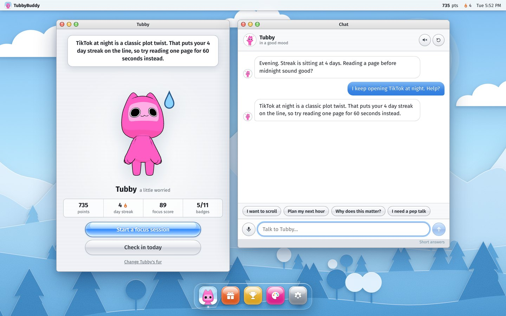
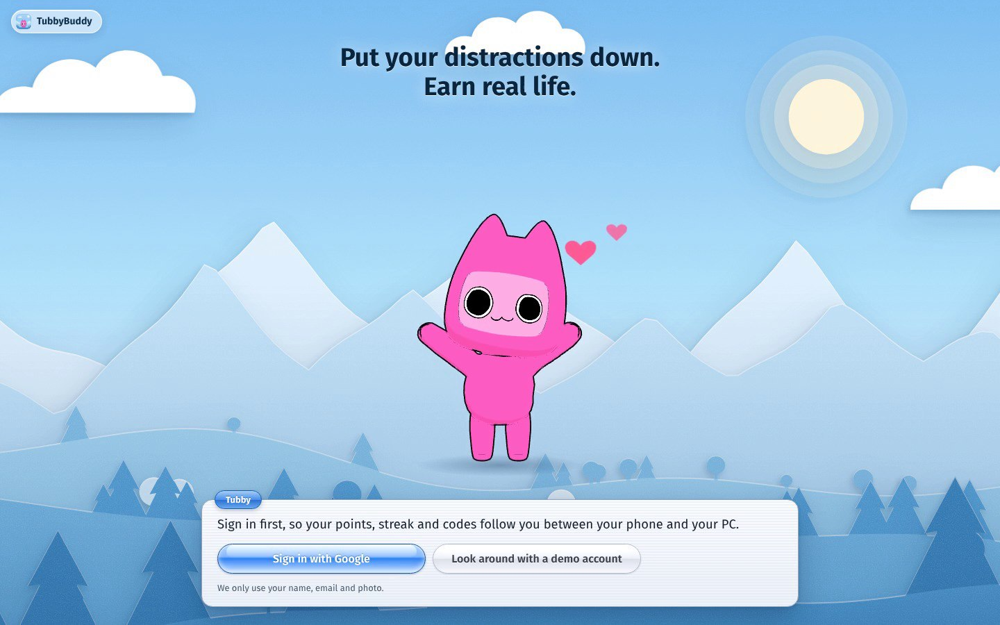
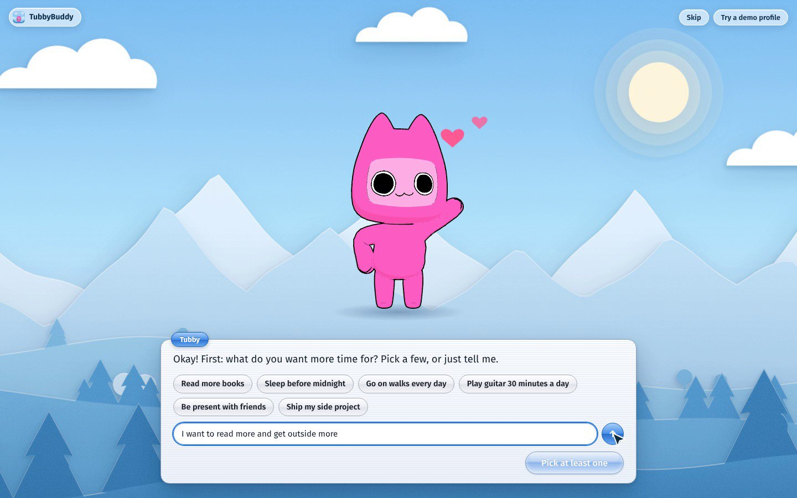
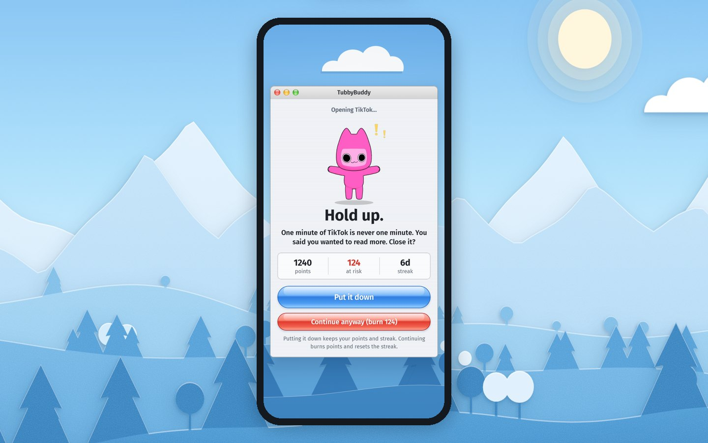
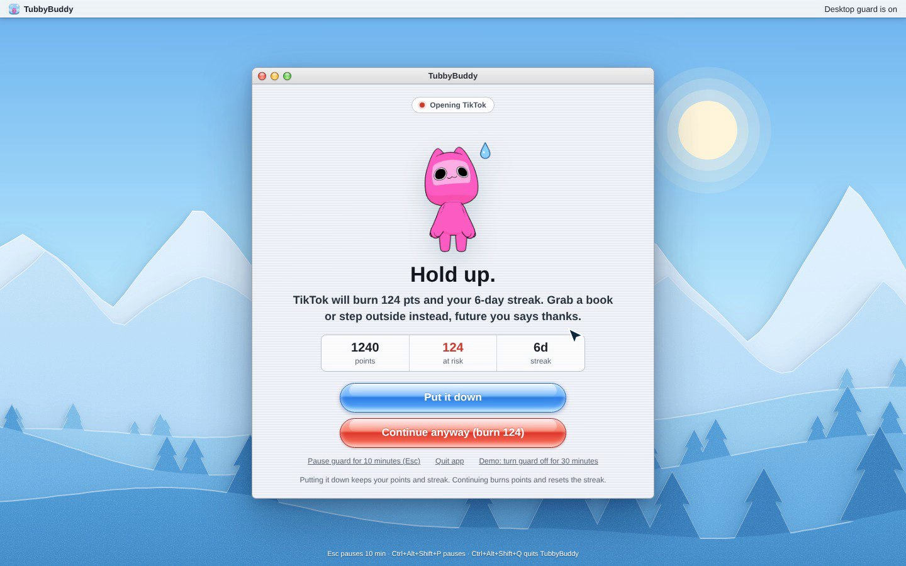
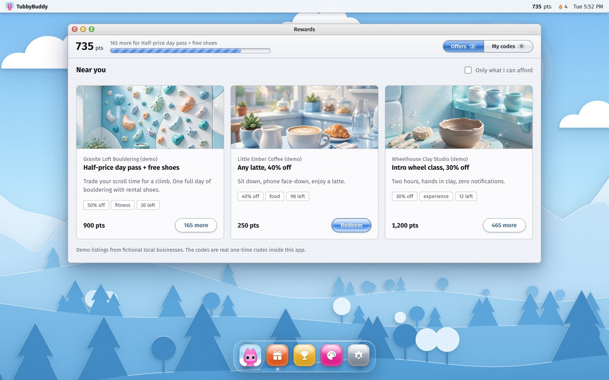
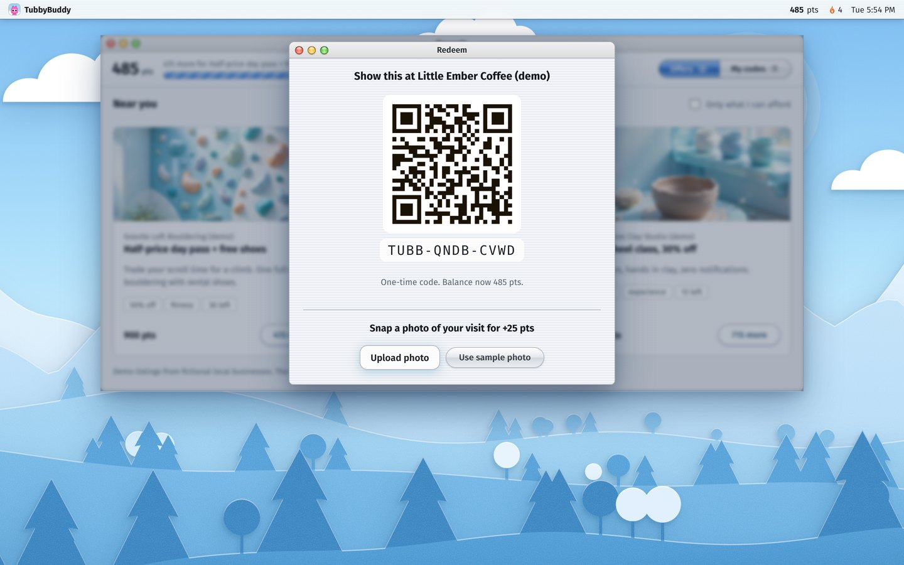
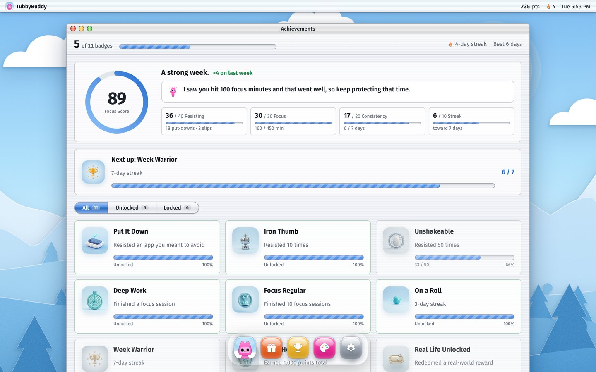
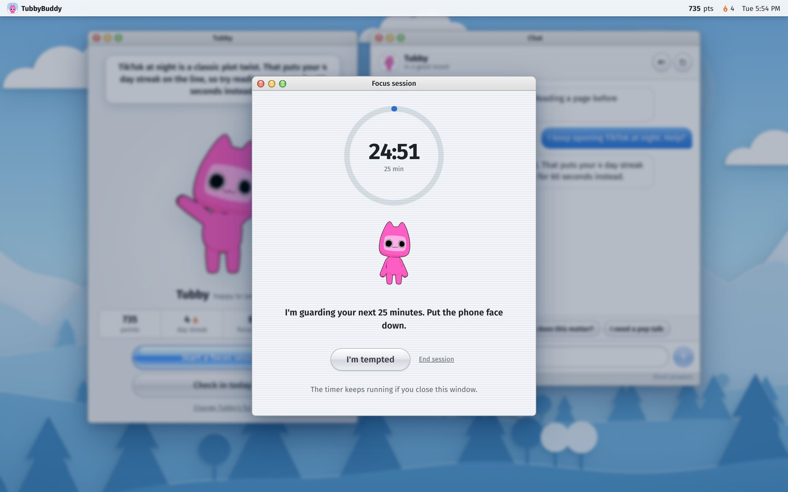

# TubbyBuddy

**Put your distractions down. Earn real life.**

TubbyBuddy is a focus app with a cat in charge. You pick the apps and sites that eat your day. When you open one,
**Tubby**, a small pink cat, steps in front of it. Put it down and your points and streak are safe. Open it anyway and
your points burn and your streak resets. Points come from finishing focus sessions and checking in, and you spend them
on real things nearby: a latte, a climbing day pass, a pottery class.

Every AI feature runs on Meta's Muse models. Built for the Meta Global AI Developer Hackathon.

**Demo video (2:22):** https://youtu.be/J8uJXpG4LBk

**Live:** https://tubbybuddy-production.up.railway.app (sign in with Google, or look around with the demo account).
The Android and Windows apps are on the [releases page](https://github.com/OWO9000/TubbyBuddy/releases/latest).



## How it works

1. **Sign in and set up.** Sign in with Google (or open the demo account). Tubby asks what you want more time for and
   which apps to guard.
2. **Get interrupted.** Open a guarded app and Tubby covers it with one short line written for you by Muse Spark.
3. **Choose.** *Put it down* keeps your points and streak. *Continue anyway* burns 25% of your balance (10–150) and
   resets the streak. The block screen can always be closed; it changes your points, never your exits.
4. **Earn by finishing.** Points come from completed focus sessions (+20), the daily check-in (+10, more with a streak)
   and a visit photo after a reward (+25). Being tempted earns nothing.
5. **Spend on real life.** Redeem an offer for a one-time code and QR, or dress Tubby in a new fur color.
6. **See the week.** A 0–100 Focus Score with a one-line note from Tubby.

**Hard mode** doubles every slip, allows fewer chat unlocks, and only lets you end a focus session early with a weekly
emergency pass.

## Built on Meta's models

The backend makes every model call through the Meta Model API. No app or browser ever holds the key.

| Feature | Model |
|---|---|
| Tubby's chat and home-screen lines, grounded in your live points, streak, goals and closest reward | Muse Spark (`muse-spark-1.3`) |
| Block-screen nudges on Android, Windows, the Chrome extension and the web preview (strict JSON schema) | Muse Spark |
| Batches of templated nudges cached on the phone, so the block screen works offline | Muse Spark |
| Splitting typed goals into separate goals with themes, which rank the rewards | Muse Spark |
| The weekly Focus Score note | Muse Spark |
| Checking the visit photo after a reward | Muse Spark (vision) |
| Reward and badge artwork | Muse Image (`muse-image-1.0`) |

Without a key, or if Muse can't be reached, the app answers from fixed offline lines and labels them **demo coach**.
Details: [docs/05-MUSE-USAGE.md](docs/05-MUSE-USAGE.md).

## Apps

| Part | What it is |
|---|---|
| `web/` | React app with every screen. The server hosts it for the browser, the Windows app ships a copy, and the Android app loads it from the server, so all three match. |
| `android/` | Kotlin. The shared screens in a WebView, plus a native guard service, block screen, permissions and app picker. Works offline and syncs. |
| `desktop/` | Windows (Electron). The shared screens, plus a tray app that watches the foreground window and browser tab titles and shows the block screen. |
| `extension/` | Chrome extension that guards exact URLs. |
| `backend/` | Node 22, Express, SQLite. Accounts, points, streaks, anti-farming limits, rate limits and the Meta client. Clients can't choose their own rewards. |

One Google sign-in keeps points, streak and codes in sync across the phone, the PC and the web.

## Screenshots

| | |
|---|---|
|  |  |
|  |  |
|  |  |
|  |  |

## Run it

Requirements: **Node 22** and a Meta Model API key from https://dev.meta.ai.

```bash
cp .env.example .env        # set META_MODEL_API_KEY (and GOOGLE_CLIENT_ID for sign-in)
npm install
npm run build
npm start                   # http://localhost:8787
```

Android, Windows, the extension, deployment and every environment variable: [docs/04-SETUP-AND-RUN.md](docs/04-SETUP-AND-RUN.md).

## Tests

```bash
npm test                                   # backend: 37 tests
(cd extension && npm test)                 # 56 URL-matcher assertions
(cd android && ./gradlew testDebugUnitTest lintDebug)   # 40 JVM tests + lint
node tools/e2e/web.mjs                     # 56 browser checks (needs a running server)
node tools/e2e/extension.mjs               # 11 extension checks
```

## Docs

| | |
|---|---|
| [01 Architecture](docs/01-ARCHITECTURE.md) | Layout, data flow, database, security |
| [02 Features and screens](docs/02-FEATURES-AND-SCREENS.md) | Every screen and the points rules |
| [03 API reference](docs/03-API-REFERENCE.md) | Every backend endpoint |
| [04 Setup and run](docs/04-SETUP-AND-RUN.md) | Environment, builds, deployment, troubleshooting |
| [05 Muse usage](docs/05-MUSE-USAGE.md) | How Meta's models are used, and Tubby's prompt rules |
| [06 Desktop app](docs/06-DESKTOP-APP.md) | The Windows guard and its safety controls |

## Limits

- Sign-in is Google only. Guest and demo profiles are protected only by their random id.
- The offers are fictional demo businesses. Codes and QRs work inside the app; merchants aren't verified.
- The desktop guard is Windows-only and matches browser tabs by title; exact URLs need the extension.
- Tubby is a focus companion, not a therapist. It gives no medical or mental-health advice.

## License

MIT. See [LICENSE](LICENSE).
