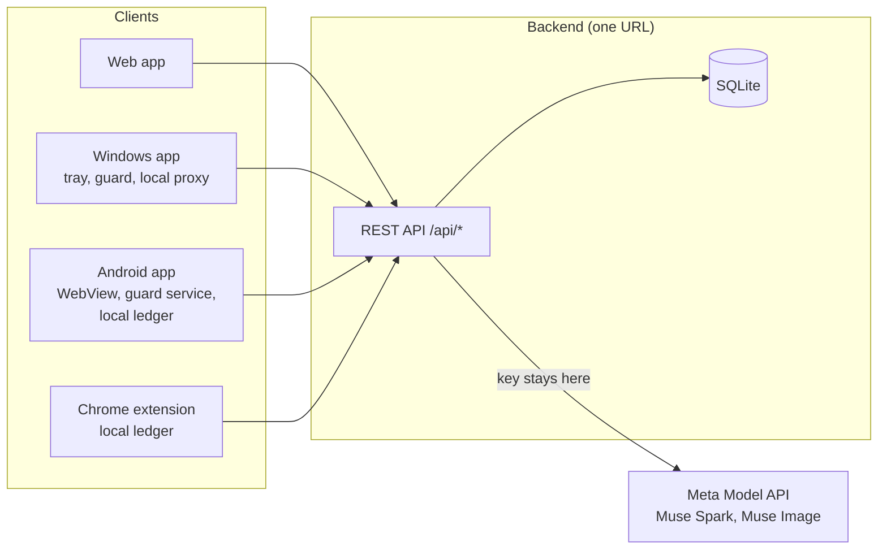
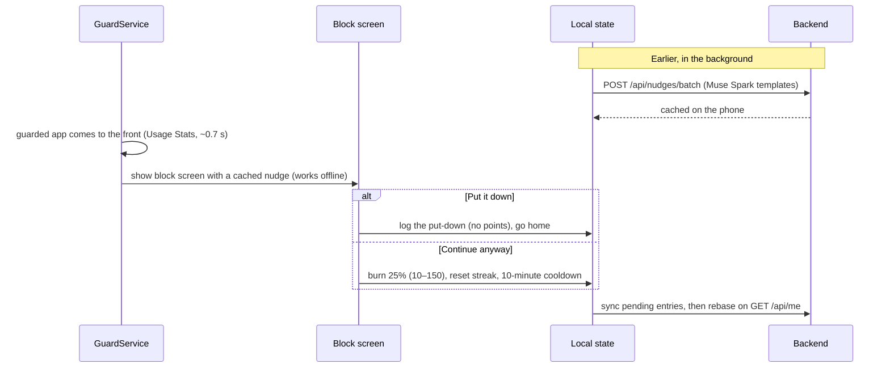

# Architecture

Some internal names (the Android package, the SQLite file, the points verb in the API) use the word "burn".

## Layout

```
├── brand.json            Product name, tagline, companion name
├── package.json          npm workspaces (backend + web) and top-level scripts
├── Dockerfile, railway.json
├── backend/              Node 22 + TypeScript + Express 5 + SQLite (better-sqlite3)
│   ├── src/
│   │   ├── server.ts, app.ts       HTTP server; routes, /media, serves web/dist
│   │   ├── config.ts               Environment, points rules
│   │   ├── db.ts, auth.ts          Schema; Google accounts, sessions, link codes
│   │   ├── ledger.ts, stats.ts     Balance, spending, achievements; journal and Focus Score
│   │   ├── meta.ts                 Meta Model API client: chat, strict JSON schema, images, daily call budget
│   │   ├── assistant.ts, demo.ts   Tubby's replies on Muse Spark; offline lines when no model is configured
│   │   ├── rateLimit.ts            Per-device and per-IP write limits
│   │   └── routes/                 assistant, auth, nudges, points, report, merchant, agent
│   ├── scripts/generate-art.ts     Reward and badge art with Muse Image
│   └── test/
├── web/                  React 18 + Vite + three.js (3D Tubby)
│   ├── public/                     3D model, Tubby frames, reward and badge art
│   └── src/                        App shell, pages (Tubby, Rewards, Achievements, Cosmetics, Settings, Link), components
├── android/              Kotlin, minSdk 26, targetSdk 34
│   └── app/src/main/java/app/burn/focus/
│       ├── ui/shell/               WebView, JavaScript bridge, phone guard screen
│       ├── ui/overlay/             Block screen (Compose)
│       ├── service/                GuardService, OverlayController, BootReceiver
│       ├── domain/                 Ledger, streak, actions, nudge cache, foreground tracking (unit-tested)
│       └── data/                   Repository (DataStore + sync), API client, permissions, installed apps
├── desktop/              Windows, Electron
│   ├── main.js, server.js, preload.js   Tray, guard loop, sign-in; local server and /api proxy; bridge
│   ├── overlay/, settings/               Block screen and guard settings windows
│   └── scripts/                          Foreground-window probe, installed-app scan, web sync
├── extension/            Chrome Manifest V3, plain JS, no build step
└── tools/e2e/            Browser checks for the web app and the extension
```

## One set of screens

Every screen is the React app in `web/`. The backend serves it at `/`. The Windows app ships a copy and serves it from a
local server. The Android app loads it from the backend in a WebView. A small bridge lets the page reach native features:

- `window.tubbyDesktop` (Windows): account, browser sign-in, guard setup, guard settings.
- `window.TubbyAndroid` (Android): profile id and session, browser sign-in, guard setup and status. It only answers
  while the WebView is on the configured server.

## Data flow



### Android block screen



## Backend

- **Validation** with zod; bad input returns `400 {error:"validation_error"}`.
- **Meta client** (`meta.ts`): timeout, retries with backoff on 408/429/5xx, and a server-wide daily call budget
  (`META_DAILY_CALL_CAP`). JSON calls always use a strict schema. Muse Spark's reasoning tokens count toward the output
  cap, so no cap is set.
- **Offline mode**: without `META_MODEL_API_KEY`, AI routes answer from `demo.ts` with the same response shapes and
  `mode: "demo"`, and the UI labels it.
- **Accounts**: Google ID tokens are verified on the server. Once a profile belongs to an account, every request naming
  it needs that account's bearer session. The phone and Windows apps sign in through the browser with one-time link
  codes; the Windows app adds its token in its local proxy, so the page never holds it.

### Database

| Table | Purpose |
|---|---|
| `users` | One row per profile: streak, best streak, equipped cosmetics, coach settings |
| `ledger` | Append-only points history; the balance is the sum of `delta` |
| `nudges` | Cached nudge templates per profile and app |
| `offers`, `redemptions` | Reward offers; issued one-time codes and visit-photo results |
| `cosmetics`, `owned_cosmetics` | Fur colors and accessories; what each profile owns |
| `accounts`, `sessions`, `link_codes` | Google accounts, sessions, browser sign-in for the apps |

The schema is created on start, and fur colors and demo offers are seeded.

## Android guard

- `GuardService` is a foreground service. It polls `UsageStatsManager` every 700 ms (3 s with the screen off) for the
  app in front. Needs Usage Access.
- The block screen is a `TYPE_APPLICATION_OVERLAY` window with Compose content. Needs "Display over other apps".
- It shows once per visit, never stacks, counts leaving the app as putting it down, and waits 10 minutes per app after
  "Continue anyway".
- Nudges come from the on-device cache (refilled from `POST /api/nudges/batch` when low or older than 6 hours) or
  built-in lines, so the block screen never waits on the network.
- Actions go into a local append-only ledger first, then sync. After sync the app rebases on the server balance; the
  server is the authority. `BootReceiver` restarts the guard after a reboot.

## Chrome extension

A content script checks each page against the blocked list (a bare domain covers its subdomains; an entry with a path
covers that path). On a match, a Shadow DOM overlay covers the page, pauses media and asks the backend for a Muse Spark
nudge (4 s timeout, then a built-in line). Single-page navigation is caught too. Network calls go through the service
worker; actions are queued locally and retried.

## Security

- The Meta key exists only on the server (environment variable or git-ignored `.env`). No client holds it, and clients
  can't change the system prompts.
- The server decides what each event is worth; spending is an atomic transaction.
- Anti-farming: put-downs pay nothing, focus sessions need a real length (5–180 minutes, at most 8 a day), check-ins
  are once per local day, and writes are rate-limited per profile and per IP.
- Conversations aren't stored on the server. The chat transcript stays in the browser and is sent back each turn.
- Error responses never include upstream headers. `.gitignore` excludes `.env*`, keystores, the database and uploads.
- Android release signing reads a properties file from outside the repo.
- Known gaps: guest and demo profiles are protected only by their random id, merchants aren't verified, and CORS is open.
